# SolomonSeal — Полный план развития

&gt; Практический roadmap на основе code review, анализа архитектуры BDoc Editor и конкурентного анализа AI coding tools.

---



---

## Обзор

**Текущее состояние:** ✅ MVP собирается и запускается в модульной архитектуре. Redaction pipeline в разработке.

**Цель:** Прозрачный, контролируемый, расширяемый LLM-оркестратор с встроенной историей изменений, маскированием секретов и плагинной системой.

---

## Фаза 0: Быстрые победы ✅ ВЫПОЛНЕНО

### 0.1 ✅ Исправить сериализацию `tool_calls`
- `ChatMessageWithToolCalls` теперь хранит `List&lt;Map&lt;String,Object&gt;&gt; toolCalls` с `@JsonProperty("tool_calls")`.
- Тесты: `AgentLoopSerializationTest` — 4 кейса.

### 0.2 ✅ Объединить HTTP-клиенты
- `AgentLoop` использует `LlmClient.complete()` вместо собственного `HttpClient`.

### 0.3 ✅ Юнит-тесты на `ToolCallParser`
- `ToolCallParserTest` — 15 тестов: три фолбэка, аргументы как объект, аргументы как строка.

### 0.4 ✅ Удалить TUI
- TUI удалён, `module-info.java` обновлён.

---

## Фаза 1: Архитектурный фундамент ✅ ВЫПОЛНЕНО

### 1.1 ✅ Разбить на Gradle-модули
| Модуль | Статус |
|---|---|
| `solomon-seal-spi` | ✅ Базовые интерфейсы (`AgentTool`, `Session`, `ToolRegistry`, `ExecutionContext`) |
| `solomon-seal-core` | ✅ AgentLoop, SessionManager, ToolRegistry, LLM-клиент, индекс |
| `solomon-seal-ui-spi` | ✅ JavaFX-интерфейсы (`ToolbarActionExtension`, `ChatPanelExtension`, `ThemeExtension`) |
| `solomon-seal-ui` | ✅ JavaFX реализация |
| `solomon-seal-app` | ✅ Точка входа `Main`, ModuleLayer-загрузчик |
| `solomon-seal-plugin-demo` | ✅ Демо-плагин с `ServiceLoader` |

### 1.2 ✅ `PluginRuntime`, `PluginContext`, `PluginDescriptor`
- Синглтон `PluginContext` с реестрами.
- `PluginDescriptor` с валидацией namespace.
- `BuiltInToolProvider` для встроенных инструментов.

### 1.3 ✅ Инвертировать `ToolRegistry`
- `ToolRegistry` опрашивает `PluginContext.collectTools()`.
- Все инструменты реализуют `spi.AgentTool`.

### 1.4 ✅ `ModuleLayer` из `plugins/`
- `PluginRuntime.loadPlugins(Path)` через `ModuleFinder` + `ServiceLoader`.
- Гибридная схема: automatic modules для библиотек, named modules для `app`/`plugin-demo`.

### 1.5 ✅ Демо-плагин
- Компилируется, регистрируется через `META-INF/services`.

---

## Фаза 2: Security & Sandbox 🔄 В РАБОТЕ

### 2.1 Redaction Pipeline 🔄 Реализация
- **Место:** между `ContextBuilder` и `LlmClient`.
- **Компоненты:**
  - `SecretPattern` — имя + regex + replacement
  - `RedactionEngine` — сканирует текст, заменяет совпадения
  - `RedactionResult` — redactedText + map placeholder→original
- **Уровни:**
  1. Статические regex (`sk-...`, `AIza...`, hex64, `ghp_...`, `Bearer\s+[\w-]+`)
  2. Динамический — значения из `SecretsManager` (ключи из `.env`, `~/.solomonseal/secrets.json`)
  3. Обратная замена не производится (плейсхолдеры остаются в логах)
- **UI:** DebugPanel показывает `&lt;SECRET:OPENAI_API_KEY&gt;` с tooltip.
- **Тест:** `RedactionEngineTest` — payload с секретом → проверка отсутствия в строке запроса.

### 2.2 Capability-based Execution
- `ExecAdapter` interface вместо прямого `Runtime.exec()`.
- Адаптеры: `GitAdapter`, `MavenAdapter`, `GradleAdapter`.
- `UnsafeBashAdapter` требует `capabilities.exec.unsafe=true`.

### 2.3 Permission Matrix в UI
- Галочки в DebugPanel/Settings.

---

## Фаза 3: Checkpointing & History (2–3 недели)

### 3.1 Operation Log
- **Хранение:** SQLite таблица `operations` в `.solomonseal/history.db` (project-bound).
- **Схема:**
  ```sql
  CREATE TABLE operations (
      id INTEGER PRIMARY KEY,
      session_id TEXT,
      step_number INTEGER,
      tool_name TEXT,
      file_path TEXT,
      operation_type TEXT, -- WRITE | EDIT | DELETE | EXEC
      old_content TEXT,    -- полный текст для WRITE/DELETE
      diff TEXT,           -- unified diff для EDIT
      undo_command TEXT,   -- для EXEC
      irreversible BOOLEAN,
      timestamp INTEGER
  );
  ```

### 3.2 CheckpointingToolRegistry
- Обёртка над `ToolRegistry`:
  - Перед `execute` — `capturePreState()` (читает old_content/diff).
  - После `execute` — `commit()` в SQLite.
- **Exec:** если адаптер вернул `undoCommand` — сохранить, иначе `irreversible=true`.

### 3.3 Timeline в DebugPanel
- Интерактивный список шагов агента.
- Каждый шаг: иконка, tool_name, краткое summary, кнопки [Diff] [Undo] [Redo].
- Дерево (не стек): при откате на шаг N и новом действии — создаётся новая ветка.

### 3.4 Session Replay
- Возможность воспроизвести все tool_calls из истории без LLM.
- Полезно для отладки: «почему агент сломался на шаге 7?»

---

## Фаза 4: Перестройка UI (2 недели)

### 4.1 Динамическая сборка UI из расширений
- `MainWindow` больше не создаёт кнопки вручную.
- `ToolbarBuilder` опрашивает `PluginContext.getToolbarActions()` + `ServiceLoader.load(ui-spi)`.
- `MenuBuilder` — аналогично для `MenuActionExtension`.
- `DebugPanelManager` — собирает вкладки от `DebugPanelContributor`.

### 4.2 ModeSwitchExtension
- `TopBar` не хардкодит Ask/Plan/Build.
- Режимы регистрируются через `ModeSwitchExtension` (встроенные — через `BuiltInPlugin`).
- Плагин может добавить «Review» или «Test» режим.

### 4.3 Темы через CSS + ThemeExtension
- Перевести `Styles.java` с inline-стилей на CSS-файлы.
- `Styles.java` — только константы имён CSS-классов.
- `ThemeExtension` позволяет плагину подменить CSS.

### 4.4 @-syntax в чате
- Пользователь пишет: `@file:src/Main.java` или `@symbol:MyClass#method`.
- Парсер чата резолвит через `ProjectIndex` и добавляет в контекст.
- Альтернатива ручному выбору `ContextProfile`.

---

## Фаза 5: Конкурентные фичи (по приоритету)

### 5.1 Cost Tracker (неделя)
- Running counter токенов за сессию.
- Учёт модели + прайса (из конфига).
- Отображение в статус-баре: «~$0.42 this session».

### 5.2 Diff-based editing для локальных моделей (неделя)
- Два режима в настройках:
  - `smart` — native tool calling (Claude/GPT).
  - `compat` — unified diff/XML в тексте (Ollama, локальные).
- `ToolCallParser` добавляет diff-парсер как 4-й фолбэк.
- System prompt автоматически подстраивается под режим.

### 5.3 Review Mode (неделя)
- Новый режим (через `ModeSwitchExtension`).
- Агент получает `git diff` и только комментирует, не правит.
- Безопасный режим для code review.

### 5.4 Post-action Hooks (неделя)
- После `WriteFileTool`/`EditFileTool` — автозапуск `mvn test` или линтера, если затронуты тестируемые файлы.
- Настраивается в `.solomonseal/hooks.yaml`.

### 5.5 Sub-agents (2–3 недели, сложно)
- Мастер-агент (Plan) координирует рабочих-агентов.
- Каждый рабочий — своя сессия, свой контекст, свой checkpoint-лог.
- Результат мёржится через `CheckpointManager`.

---

## Что НЕ делать (anti-roadmap)

| Фича | Почему нет |
|---|---|
| Voice mode | Не критично для desktop coding tool, можно через OS |
| Browser automation | Уже есть `WebFetchTool`, полноценный браузер — оверкилл |
| Real-time collaboration | Не целевой сценарий |
| Собственная модель (fine-tune) | Дорого, не даёт преимущества для harness |
| Mobile клиент | JavaFX не портируется, отдельный проект |
| Поддержка всех IDE (VS Code extension) | Не целевой сценарий, SolomonSeal — standalone tool |

---

## Критерии готовности MVP

1. **Архитектура:** модули `core`, `spi`, `ui-spi`, `ui`, `app`, `plugin-demo` собираются.
2. **Плагины:** демо-плагин загружается из `plugins/` и добавляет UI-элемент.
3. **Security:** redaction pipeline маскирует `sk-...` в payload.
4. **Sandbox:** `BashTool` работает только через адаптеры, unsafe exec требует explicit enable.
5. **Undo:** можно откатить отдельный tool_call из DebugPanel.
6. **Тесты:** `ToolCallParser`, `PluginContext`, `CheckpointManager` покрыты юнит-тестами.
7. **Стабильность:** 10 последовательных сессий Plan→Build без падений.

---

## Оценка времени

| Фаза | Срок | Результат |
|---|---|---|
| Фаза 0 | 1–2 недели | Исправлены баги, есть тесты, один клиент |
| Фаза 1 | 2–3 недели | Модульная архитектура, плагины грузятся |
| Фаза 2 | 2 недели | Секреты не утекают, exec контролируется |
| Фаза 3 | 2–3 недели | Operation-level undo, timeline, replay |
| Фаза 4 | 2 недели | Динамический UI, темы, @-syntax |
| Фаза 5 | 4–6 недель | Cost tracker, diff fallback, review mode, hooks |
| **Итого MVP** | **~10 недель** | Полноценный продукт с уникальными фичами |

---

## Уникальные фичи SolomonSeal (чего нет у конкурентов)

1. **Детерминированная сборка контекста** без LLM-оркестратора (`DeterministicContextAssembler`).
2. **SQLite-индекс с FTS + JavaParser** — быстрый символьный поиск по проекту.
3. **Встроенный WebFetchTool** — редкость в desktop tools.
4. **Режимы Ask/Plan/Build** с жёсткими permission-границами (`ToolPermission`).
5. **Operation-level undo** без git — selective revert любого шага агента.
6. **Прозрачность cost + payload** — пользователь видит всё до отправки.
7. **Плагинная система** — расширяемость инструментов, UI и режимов.
